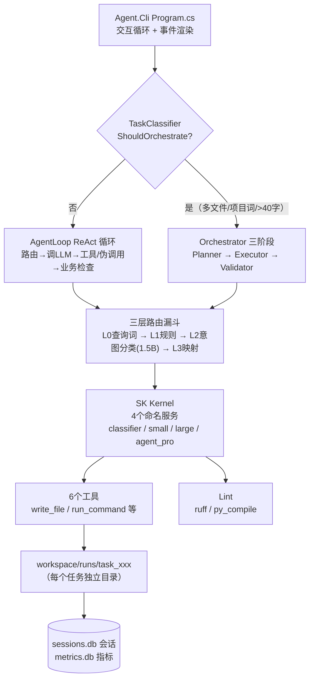

# LocalAiWorkbench 项目交接文档

> 撰写日期：2026-09-22（基于源码通读 + 真实构建验证 + workspace 运行数据核对）
> 状态更新（截至 22:10）：15:47 修复编译错误（构建 0 错误）；18:10 修复「规则 F 冲突」打通 C# 多文件；
> **10-01 OutputVerifier 抽取（§14-3e）：双路径检查链（凭据/stderr 剥离/结构/通用失败+双容错/占位）收敛为 Quality/OutputVerifier.cs 公共类单一来源（AgentLoop 1002→891、Orchestrator 966→801），构建 0 错误，28 项确定性回归全部通过**
> **10-01 Ollama 自动启动（§14-3f）：健康检查检测到 Ollama 未启动时，自动执行 `ollama serve`（后台常驻）+ 轮询就绪（1s×15），并注入 OLLAMA_MODELS 模型库根（默认库空时回退 X:\ollama\models，实测 10 模型全恢复）；端到端实测通过**
> **10-01 环境约束注入（§14-3g）：ExternalTaskDetector 任务类型识别（外部数据任务：天气/IP 定位/汇率等）→ 生成阶段注入环境约束数据块（免 Key + timeout=8 + 快速失败），AgentLoop / Orchestrator / ExecutorService 三路径单一来源；复测：天气任务成功（106s，模型直接采用 ip-api.com+wttr.in+timeout=8）对比此前失败（253s 挂死）**
> **10-01 写入时 timeout 静态检查（§14-3h）：WriteFileTool 对 .py 写入强制外部 HTTP 调用补 timeout=8（无 timeout 补、已带/跨行/非 py 不动），兜底"模型漏写 timeout"形态；复测：天气任务再次成功（115s，两处 requests.get 均 timeout=8）**
> **10-01 P0 可持续化（§14-3i）：git init 本机仓库（已有 Git 配置，基线 9affee6 + P0 9dc15b5）；ovtest 33 断言收敛为正式工程 tests/Agent.Infrastructure.Tests（入 slnx，dotnet run 一键回归）；死配置清理（RoutingRules 重名→complex_local/complex_cloud、删未接线的 EnableOrchestration、Core.csproj 残留 SK Ollama 包引用、slnx 空 folder）；冒烟质数任务路由正常**
> **10-01 P1 交互/守护强化（§14-3j）：新建 Tools/PyCodeGuard.cs（EnsureHttpTimeout 从 WriteFileTool 移入单一来源 + DetectInteractive 交互拦截：.py input / .cs Console.ReadLine 写入即拒绝，防 30s 挂死）；WriteFileTool/EditFileTool 共用；约束块通用化（去天气专用表述）；汇率任务回归成功（免 Key+timeout+快速报错）；C# HttpClient 结论：默认 100s 超时，30s kill 更早触发，无需扩展**
>
> **18:23 完成 3 案例多文件回归（订单 / 待办 / 学生全部一次编译通过）**
>
> **19:05–20:20 负向回归 6 任务 + 方案 1+3 / 2 / A / B（§11.5）；20:30–21:30 三项新防线（§11.5.6）；21:30–22:10 双路径统一 + 免 Key 闭环（§11.5.7）：JSON/凭据/stderr 同步 Orchestrator、通用失败词替代精确词表、wttr.in 免 Key 实现实证成功**


***

## 0. 一句话摘要

本地优先（Local-first）的 AI 编码 Agent 工作台：.NET 10 控制台应用，用户在 CLI 输入自然语言需求，系统在**本地 Ollama 小模型 + 云端 DashScope 大模型**之间做智能路由，自动完成「规划 → 生成代码 → 写文件 → 运行验证 → 出错自动修复」的闭环，并用 SQLite 记录会话与任务指标。


| 项目   | 说明                                                                                                                     |
| ---- | ---------------------------------------------------------------------------------------------------------------------- |
| 解决方案 | `LocalAiWorkbench.slnx`（新版 XML solution 格式）                                                                            |
| 目标框架 | net10.0（**已在产物中强制 net10.0，勿降级**）                                                                                       |
| 核心依赖 | Microsoft.SemanticKernel 1.80.1、SK OpenAI Connector（走 Ollama `/v1` 与 DashScope 兼容端点）、Microsoft.Data.Sqlite 11.0.0-rc.1 |
| 版本控制 | **未纳入 git**（无 .git 目录），无测试工程                                                                                           |
| 入口   | `dotnet run --project src/Agent.Cli`，需先 `ollama serve`                                                                 |


***

## 1. 三层项目结构


| 项目                     | 职责                              | 依赖                    |
| ---------------------- | ------------------------------- | --------------------- |
| `Agent.Core`           | 抽象接口 + 纯模型（设计目标零依赖）             | 无（见 §12-10 的残留包说明）    |
| `Agent.Infrastructure` | 全部实现：主循环、编排、路由、工具、Lint、指标、会话    | Core + SK + Sqlite    |
| `Agent.Cli`            | 控制台入口：交互循环、事件渲染、模型健康检查、run 目录清理 | Core + Infrastructure |

### 1.1 Agent.Core（约 450 行）


* `Abstractions/`


  * `IAgentLoop.cs`：`RunAsync` 返回 `IAsyncEnumerable<AgentEvent>`—— 事件流式产出，为前端 / UI 预留

  * `IAgentTool.cs`：工具契约（Name / Description / InputSchema / InvokeAsync）

  * `IToolRegistry.cs`、`ISessionStore.cs`

* `Models/`


  * `AgentOptions.cs`：全部可调参数 + `ModelEndpoint`（Provider/Model/Endpoint/ApiKey）

  * `AgentEvent.cs`：record 事件层级（Thinking / ToolCall / ToolResultEvent / FinalAnswer / Error / Routing / PlanGenerated / FileWritten）

  * `AgentRequest.cs`、`ChatTurn.cs`（Core 零依赖，不引 SK 类型）

  * `Plan.cs`：`Plan` + `FileSpec`（Planner 输出结构，JSON snake\_case 映射）

  * `SystemPrompt.cs`：ReAct 模式系统提示词（内置大量踩坑规则）

  * `TaskMetric.cs`：19 字段指标模型

### 1.2 Agent.Infrastructure（约 4100 行，核心实现）


| 目录 / 文件                            | 职责                                                                          | 行数    |
| ---------------------------------- | --------------------------------------------------------------------------- | ----- |
| `AgentLoop.cs`                     | ReAct 主循环（§11 编译修复；§11.5.4/11.5.6/11.5.7 凭据+空答案+stderr 白名单+通用失败词+免 Key 注入；§14-3e 检查链改调 OutputVerifier；§14-3g 用户消息附加环境约束）        | 896   |
| `Orchestration/Orchestrator.cs`    | 三阶段编排 Planner→Executor→Validator（§11.5.3/11.5.7 凭据+通用失败词+JSON 双路径统一；§14-3e 检查链改调 OutputVerifier；§14-3g 环境约束注入 Planner+Plan）         | 812   |
| `Quality/OutputVerifier.cs`        | **run_command 输出判定公共验证器**（凭据/stderr 剥离/结构/通用失败+双容错/占位；agent+orchestrator 双路径共用**单一来源**，根治双路径不一致，§14-3e） | 271   |
| `Orchestration/PlannerService.cs`  | 生成结构化 Plan + `SimplifyRunCommand` 后处理硬化（§12-1 多文件规则；§11.5.2 截断防护）           | 790   |
| `Orchestration/ExecutorService.cs` | 逐文件生成 / 修复代码（§14-3g 生成/修复消息附加 plan.EnvironmentConstraint）                                | 661   |
| `Orchestration/TaskClassifier.cs`  | 纯规则判断走编排还是 ReAct                                                            | 103   |
| `Routing/ExternalTaskDetector.cs`  | **外部数据任务识别**（确定性词表：天气/IP 定位/汇率等 → 环境约束数据块，§14-3g）                    | 66    |
| `Routing/`                         | 三层漏斗路由（ModelRouter / RuleEngine / IntentClassifier / RoutingRules.json）     | \~480 |
| `Tools/`                           | 6 个工具（list\_dir/read\_file/write\_file/edit\_file/create\_dir/run\_command） | \~630 |
| `Quality/PythonLintService.cs`     | ruff 优先，py\_compile 降级；F821/F811 阻断                                         | 189   |
| `Metrics/`                         | SqliteMetricsCollector + AgentLoop/Orchestrator 两个装饰器                       | \~500 |
| `Session/SqliteSessionStore.cs`    | turns 表存对话历史                                                                | 108   |
| `KernelFactory.cs`                 | 注册 4 个命名 ChatCompletion 服务                                                  | 72    |
| `DependencyInjection.cs`           | `AddAgent(options, workspaceRoot, dbPath)` 一站式装配                            | 126   |
| `RetryHelper.cs`                   | 指数退避重试（1s,2s,4s…）                                                           | 68    |

### 1.3 Agent.Cli


* `Program.cs`（849 行）：配置区 → 健康检查（§14-3f Ollama 连接失败自动启动+轮询+OLLAMA_MODELS 注入）→ 交互循环 → 自动分发；含 `plan` / `orch` / `stats` 调试命令（带「临时测试」注释，未清理）。


***

## 2. 架构总览




核心要点：


* **两条执行链路**共用一个 Kernel 与工具集；CLI 启动时为整个会话建一个「根 DI 容器」，**每个任务再建一个独立 DI 容器**（因工具构造时绑定 `workspaceRoot`，必须指向该任务的子目录）。

* 所有事件以 `AgentEvent` 流式吐出，CLI 只负责渲染 —— 这是为将来接 UI 预留的接口。

* 全部本地调用统一传 `"think": false`（ExtensionData）关思考加速（从 DashScope 经验迁移）。


***

## 3. 模型端点配置（AgentOptions）


| 服务 ID        | Provider             | 当前模型                                            | 用途                                | 超时               |
| ------------ | -------------------- | ----------------------------------------------- | --------------------------------- | ---------------- |
| `classifier` | Ollama :11434        | qwen2.5:1.5b                                    | 意图分类（温度 0，极短 prompt）              | HttpClient 10 分钟 |
| `small`      | Ollama :11434        | qwen3-coder-flash-custom（注释备选 qwen2.5-coder:7b） | Executor 代码生成 / 简单任务              | 10 分钟            |
| `large`      | DashScope（openai 兼容） | qwen3.8-27b                                     | Search / Unknown 兜底               | 5 分钟             |
| `agent_pro`  | Ollama :11434        | qwen3.5:4b                                      | Planner 规划 / ComplexReason / 失败升级 | 10 分钟            |

行为参数：`MaxSteps=20`、`MaxHistoryTurns=10`、`Temperature=0.2`、`ExecutorMaxRetries=3`、`ComplexToPro=true`（ComplexReason 走本地 4B 而非云端，省钱）。大模型 Key 读环境变量 `DASHSCOPE_API_KEY`（缺失时启动黄色提示，路由到 large 会失败）。

> **模型库位置（接手必知）**：Ollama 模型库根在 **`X:\ollama\models`**（实测 10 个模型：qwen3-coder-flash-custom/opt/agent、anarko/qwen3-coder-flash:30b、qwen2.5:1.5b、qwen3.5:4b、qwen2.5-coder:7b、nomic-embed-text 等），**用户环境未设 `OLLAMA_MODELS` 变量**——手动 `ollama serve` 会读默认空目录（`%USERPROFILE%\.ollama\models`，blobs 为 0）导致健康检查模型全 FAIL。CLI 自动启动（§14-3f）已做探测注入：进程环境有变量则继承，否则默认库有模型则不注入，否则回退 `X:\ollama\models`。


***

## 4. 执行链路 A：AgentLoop（ReAct 单模型循环）

触发：`TaskClassifier.ShouldOrchestrate(input) == false`（单文件词 / 查询词 / 设计词 / 默认）。

流程（`AgentLoop.RunAsync`，MaxSteps=20）：


1. **模糊输入检测**（"写一个函数" 等 ≤10 字无细节）→ 直接提示补充需求。

2. **载入会话历史**（SQLite 最近 10 轮）→ `IsNewTask` 命中（"写一个 / 创建…" 且无后续词）则清空历史。

3. 每步先做**路由决策**：首轮决策缓存复用；上一步失败则重新路由（触发升级）。

4. 调 LLM（`FunctionChoiceBehavior.Auto(autoInvoke:false)`），按响应分三种情况：

* **情况 A：SK 结构化 FunctionCall** → 逐个执行工具，结果以 `FunctionResultContent` 回填 chatHistory。

* **情况 B：纯文本 JSON 伪工具调用**（`{"name":..., "arguments":...}`）→ 手写花括号匹配解析成伪调用再执行。**这是小模型不走原生 function calling 的稳定性兜底，不要删。**

* **情况 C：最终答案** → 过「业务合理性检查」：


  * 代码请求但没写文件 → 注入 user 消息强制写（连续 3 次拒绝 → 报错终止）

  * 写了文件但没 run → 强制运行

  * 只 build 没 run（用户要比较 / 输出 / 演示）→ 强制 `dotnet run`

  * 运行失败 → 强制修复

  * 输出疑似 Hello World 模板 → 强制重做

  * 纯设计类请求（设计 / 规划 / 架构 / 方案 且无写代码词）→ 直接交付

1. **工具结果 4 道判定**（`ExecuteToolAsync`）：退出码 ≠ 0 /stderr 错误信号 /stdout 结构性错误（Traceback、error CS…）/ 占位符与模板输出检测 —— 任一命中判失败并触发路由升级。


***

## 5. 执行链路 B：Orchestrator（Planner → Executor → Validator 三阶段）

触发：`ShouldOrchestrate == true`（强多文件词 / 项目词 / 输入 > 40 字）。


1. **Planner**（agent\_pro 4B，温度 0.1）：输出结构化 Plan JSON（summary/language/files \[{path,purpose,requirements,skeleton}]/run\_command/expected\_output）。空输出重试 3 次、解析失败带错误反馈重试 1 次。**后处理&#x20;**`SimplifyRunCommand`**&#x20;做了大量硬化**（务必保留，全部是踩坑对策）：

* 提取用户指定文件名（如 parse\_csv.py）强制入口改名并重建 run\_command

* 简化 run\_command（python xxx.py/node xxx.js/dotnet run）

* 禁词替换：matplotlib→ASCII 图、numpy→list/dict、pandas→csv 模块、requests→urllib.request、flask/django→标准库

* 过滤独立示例数据文件（create\_sample/init\_db/seed…）→ 职责并入入口脚本

* 强制注入「数据文件不存在则创建」、argparse 必须有 default、csproj 用 net10.0

1. **Executor**（small coder 模型，温度 0.1）：按 Plan 文件顺序逐文件生成；**已生成文件内容截断 1500 字符作为上下文传给后续文件**（保证接口一致）；后处理强制 argparse default、csproj TargetFramework。

2. **Validator**（循环，最多 ExecutorMaxRetries=3）：

* 先 Lint（ruff，F821/F811 阻断）→ 不过则按文件分组调 `FixFileAsync` 修复 → 回顶部重 Lint

* Lint 过 → 跑 run\_command（C# 自动补 `--project`）→ 失败则用正则从错误输出定位文件（支持 `File.cs(行,列): error CSxxxx`、`File "xxx.py"`、argparse usage 兜底、入口文件名兜底）→ 修复 → 重跑

* **修复内容与原文 diff 率 < 2% 视为「模型没理解」→ 终止**；最终成功 / 失败写入指标

1. C# 运行命令的 `--project` 注入：找到 Plan 里的 .csproj，把 `dotnet run` 改写成 `dotnet run --project xxx.csproj`（避免多 csproj 冲突）。


***

## 6. 路由体系（三层漏斗）


```
L0 查询词硬编码拦截（ModelRouter 内："看看/查看/看一下/列出/显示/有哪些文件/什么文件"）→ small

L1 规则引擎（RoutingRules.json，priority 降序）

L2 意图分类（qwen2.5:1.5b，/no\_think 极短 prompt，温度 0，输出 6 类之一）

L3 意图 → 服务映射：

&#x20;  SimpleQA / CodeGenerate / FileProcess → small

&#x20;  Search / Unknown → large

&#x20;  ComplexReason → ComplexToPro ? agent\_pro : large
```

规则类型：`regex` / `keyword_any` / `prefix_any` / `length_min` / `length_max` / `after_failure`（上一步失败 → 升级 agent\_pro，priority 200，最高）。

RoutingRules.json 当前 9 条规则（含 2 条重名 `complex_keywords`，见 §12-3）。


***

## 7. 工具层（6 个，全部绑定 workspaceRoot，路径越界检查）


| 工具            | 要点                                                                                                                                                                      |
| ------------- | ----------------------------------------------------------------------------------------------------------------------------------------------------------------------- |
| `list_dir`    | 列出 \[DIR]/\[FILE]（含大小）；空目录给明确提示                                                                                                                                         |
| `read_file`   | 上限 200KB                                                                                                                                                                |
| `write_file`  | **大量后处理**：csproj 强制 net10.0 + obj/bin 隔离路径（防多项目共享 obj 冲突）；py 强制 argparse default；.cs 文件同目录无 csproj 时**自动补建**；csproj 文件名异常自动改名；拒绝空内容（白名单 `__init__.py` 等除外）              |
| `edit_file`   | old\_string 必须唯一，否则报错；拒绝空 old\_string                                                                                                                                   |
| `create_dir`  | 幂等                                                                                                                                                                      |
| `run_command` | **白名单**（python/dotnet/node/git/dir/ls/…）；禁 `-c`/`-e` 内联执行；30 秒超时并杀进程；`chcp 65001` + UTF-8 输出；`-p` 自动规范化为 `--project`；**超时返回&#x20;**`退出码：124`（2026-09-22 15:10 修复，见 §11） |


***

## 8. CLI 命令


| 命令                                          | 作用                                                     |
| ------------------------------------------- | ------------------------------------------------------ |
| 普通输入                                        | 自动分发（TaskClassifier），每任务建 `task_xxxxxx` 子目录 + 独立 DI 容器 |
| `plan <需求>`                                 | 只测 Planner，打印 Plan（调试用，带「临时测试」注释）                      |
| `orch <需求>`                                 | 只测 Orchestrator 全流程（调试用）                               |
| `stats` / `stats recent` / `stats failures` | 指标汇总 / 最近 10 条 / 最近失败                                  |
| `new`                                       | 开新会话（换 sessionId）                                      |
| `exit`                                      | 退出                                                     |

启动时：本地模型健康检查（Ollama `/api/tags` 探活 + 逐个模型是否已 pull，缺失给 `ollama pull` 命令）+ 清理 7 天前或超 50 个的旧 run 目录。


***

## 9. 数据落盘（workspace/）


* `sessions.db`：`turns` 表（session\_id /role/content /created\_at），241 行 / 74 会话（9-22 15:00 核对，此后新增未重计）

* `metrics.db`：`task_metrics` 表 19 列（模式、路由、成败、is_suspicious、重试数、各阶段耗时、lint 错误数、错误摘要），**58 条：40 成功 / 18 失败（69.0%），21 agent / 37 orchestrator，平均修复 0.47 次，平均耗时 123.7s**（9-22 22:10 核对）。注意：空答案 / 异常终止路径**不落指标**（见 §11.5.4）；成功率低主因是天气系列复测大量如实判失败（凭据 / 网络 / 模型能力），非回归退化

* `runs/<时间戳-随机4位>/task_<8位id>/`：每个任务独立工作区，共 51+ 个 run 目录

* 生成产物：C# **多文件项目已打通**（订单 / 待办 / 学生 3 案例验证，均 csproj + 模型 + 服务 + 入口 四文件一次编译通过）；此前均为单文件 C# 或单文件 Python


***

## 10. 当前实测能力（截至 2026-09-22 18:25）


* Python 单文件脚本（fib.py/prime.py/get\_ip.py/calculate\_stats.py/ 购物车类）基本稳定

* C# 单文件项目（订单管理 / TodoApp）成功，耗时 143–210 秒（本地模型慢）

* **C# 多文件项目已打通并完成 3 案例回归**（18:10–18:23，全部一次编译运行通过，无验证重试）：


  * 订单系统：OrderSystem.csproj + Order.cs + OrderService.cs + Program.cs（81.5s）

  * 待办事项：TodoProject.csproj + Todo.cs + TodoService.cs + Program.cs（99.3s）

  * 学生管理：Student.csproj + Student.cs + GradeService.cs + Program.cs（88.7s）

* 超时修复已生效：17:53 的交互式计算器任务（Console.ReadLine 循环）被判 **FAIL**（249 秒），不再假阳性成功

* **负向回归 6 任务**（19:05–19:16）暴露 3 类缺口：Planner 输出截断无兜底、语义失败假阳性成功、修复器对无行列号错误无能为力 —— 均已加固或明确定界（§11.5）

* **凭据型外部 API 缺口已堵**（20:05 天气任务失败 → 方案 A+B）：401/403/API key 类失败会判失败并引导改用免 Key 实现；空最终答案不再静默"[完成]"而是重试 1 次后明确报错（§11.5.4）


***

## 11. ⚠️ 历史编译故障与修复记录（已于 2026-09-22 15:47 修复并验证）

> **现状：已修复。**
>
>  
>
> `dotnet build`
>
>  通过（0 错误，2 个既有 CS8602 警告），冒烟运行正常。以下为修复过程留档。

**2026-09-22 15:10 对&#x20;**`AgentLoop.cs`**&#x20;/&#x20;**`Orchestrator.cs`**&#x20;/&#x20;**`RunCommandTool.cs`**&#x20;的修改曾引入编译错误，导致&#x20;**`dotnet build`**&#x20;失败：**


```
src\Agent.Infrastructure\AgentLoop.cs(726,10): error CS1513 应输入 }
```

### 根因（已逐行定位 + 临时副本验证）

`AgentLoop.ExecuteToolAsync` 的 `try` 块缺少闭合 `}`，且最终 `return (output, true);` 被移到了 `if (name == "run_command")` 块内部。修复后还会暴露第二个错误：


```
AgentLoop.cs(554,50): error CS0161 并非所有的代码路径都返回值
```

### 修复方法（已应用并验证：真实构建 0 错误编译，仅剩 2 个既有 CS8602 空引用警告）

找到 `AgentLoop.cs` 中 `ExecuteToolAsync` 的这段（当前约 723–727 行）：


```
&#x20;           return (output, true);

&#x20;       }

&#x20;       catch (Exception ex)
```

改为：


```
&#x20;           return (output, true);

&#x20;           }

&#x20;           return (output, true);

&#x20;       }

&#x20;       catch (Exception ex)
```

即：**补一行&#x20;**`return (output, true);`**（非 run\_command 路径的正常返回值）和一行&#x20;**`}`**（闭合 try 块）**，放在 `catch` 之前。

### 这次修改同时带来一个好消息

15:10 的改动实际上**修掉了「超时误判成功」的历史漏洞**：


* `RunCommandTool` 超时输出现在带 `退出码：124`（此前只有 "错误：命令执行超时"，不含退出码，被下游误判成功）

* `Orchestrator.RunCommandAsync` 与 `AgentLoop.ExecuteToolAsync` 都新增了 `result.StartsWith("错误") → 判失败` 的检查

* 修复后交互式死循环程序会被正确判失败（17:53 计算器任务已实证判 FAIL）


***

## 11.5 2026-09-22 晚：负向回归与四项加固（全部已应用并验证）

### 11.5.1 负向场景回归 6 任务（19:05–19:16，run 20260922-190538-9aee）

用户按 §14 建议构造 6 个负向任务实测「验证-修复闭环」：

| 任务 | 结果 | 结论 |
| --- | --- | --- |
| 银行账户#1（自定义异常类） | **Planner JSON 输出在 requirements 的 "using" 处截断 → 解析失败、重试 1 次仍失败 → "[错误] 规划失败，任务终止"** | 新缺口：截断无兜底 → 方案 1+3 |
| 仓储（泛型接口+内存实现） | 6 文件退出码 0，但 stdout "未找到ID为1的产品" → **假阳性成功** | 根因：Product 用 `Guid.NewGuid().GetHashCode()` 做 Id（随机），查 GetById(1) 必失败；退出码 0 骗过检查 → 方案 2 |
| 订单明细（Order+OrderItem+总价） | 5 文件运行成功，总价 45.49 vs 预期 300.00 | 软指标偏差，设计行为（§12 多文件观察） |
| 日志（ILogger+两实现+注入） | 6 文件运行成功，log.txt 实际落盘 | 正常（构造函数注入 OK） |
| 图形面积（抽象基类+多态） | 5 文件运行成功，面积 12.566/12 正确 | 正常（AreaCalculator.csproj 语义命名生效） |
| 银行账户#2（重试） | Planner 空输出 2 次、第 3 次成功；首 run 退出码 1 → CS0272（Account.Balance set 不可访问）→ 定位 Program.cs → 修复 → 重跑 0 | **「验证-修复闭环」首次实战成功** |

### 11.5.2 方案 1+3：Planner 截断防护（PlannerService.cs，已应用，构建 0 错误）

* 规划规则新增：每条 `requirements` **≤40 字**（实测过长输出会被截断）、文件数上限 **≤6**
* 规则 G 新增：csproj **项目名必须与任务相关**（不再复用 OrderSystem.csproj）、**requirements 里不要写任何 using 指令**（这是截断触发点）
* 解析失败重试 **1→2 次**，重试提示明确"可能是被截断" + 给出完整 JSON 结构模板
* 验证：`plan` 命令实测完整 JSON 无截断；银行账户修改后日志（task_e5195ae0）三项预期全部命中，且新增 CS7036 跨文件构造签名错误被修复闭环正确处理（定位 Account.cs → 补参 → 重跑 0）——**修复闭环第 2 次实战成功**

### 11.5.3 方案 2：语义失败信号检查（Orchestrator.cs，已应用，构建 0 错误）

* `RunCommandAsync` 新增 check 3.5：退出码 0 后、占位符检查前 —— stdout 含语义失败信号（未找到 / not found / not exist / 添加失败 / 创建失败 / 保存失败 / 删除失败 / 查询失败 / 更新失败 / 读取失败 / 写入失败 / 加载失败 / 操作失败 / 处理失败 / failed to / add failed）且 expected_output 未含该信号 → 判失败进修复闭环；**容错**：预期本身含信号 = 任务要演示失败路径，放行
* 命中时错误信息附加 `计划预期输出：{plan.ExpectedOutput}`，请模型"使实际输出与计划预期一致"（**数据补丁，不动 System prompt**，见 §11.5.5）
* 验证：回归 1 仓储一次通过无误伤；回归 2 产品查询真实拦截缺陷程序（输出"未找到产品"+ 漏 ID 2），但进入修复后 **FixFileAsync 返回与原文完全相同 → "模型没理解"守卫终止**（修复器提示词只有编译错误类诊断，无"语义失败"类，见 §12-14）

### 11.5.4 方案 A+B：凭据失败检查 + 空答案兜底（AgentLoop.cs，已应用，构建 0 错误）

* **A（检查 0.5）**：run_command 判定层新增外部凭据失败信号 `\b401\b`/`\b403\b`/`unauthorized`/`invalid api key`/`api key`/`api_key`/`appid`/`无效的密钥`/`认证失败` 等 → 判失败并注入指令"改用无需凭据的实现（如 wttr.in 免 Key 天气服务，或本地模拟/示例数据）"。背景：20:05 天气任务模型写 OpenWeatherMap + `YOUR_API_KEY` 占位 → 401 失败 → recovery 升级 agent_pro → **返回空答案 → 静默"[完成]"**（会话库留空 assistant 轮、指标不落）
* **B（空答案兜底）**：情况 C 入口 —— 模型返回空内容 → 重试 1 次，仍空 → `[错误] 模型连续返回空答案，任务终止`，不再静默交付
* 验证（重跑天气任务，task_34f710fb）：**B 端到端实测**——空内容 → "模型返回空内容，强制重试" → 仍空 → 明确报错终止；A 本轮未触发（失败提前发生在 `import requests` ModuleNotFoundError），但代码分析确认 20:05 的 401 输出必命中信号表

### 11.5.5 打地鼠规避原则（用户确认的开发约束）

* 对"语义失败修复器无从下手"，**否决**了"给 FixFileAsync 提示词加语义失败诊断类"（提示词工程打地鼠），改为**数据结构性补丁**：check 3.5 命中时把 `计划预期输出` 附进错误信息，System prompt 不动
* 信号表保持当前**最小集不随案例膨胀**（语义信号 15 个、凭据信号 11 个）；若补数据后仍失败，接受"明确失败 + 展示预期 vs 实际"为终态，不靠堆规则掩盖

### 11.5.6 20:30–21:30 三项新防线（全部已应用并验证）

**① stderr 无害警告白名单（检查 2 重构）**
* RequestsDependencyWarning（requests 库版本兼容提示，写入 stderr 但无害）此前会触发"stderr 非空即失败"，误伤成功程序。现在先按 `^.*RequestsDependencyWarning.*` 块（含其后缩进的 warnings.warn( 延续行）剥离，剥离后为空则放行
* 验证：21:01 复测任务 stderr 有该 Warning，**不再误判失败**（首次实战）

**② stdout JSON 错误检测（检查 3.5 扩展）**
* 原检查 3.5 只匹配以 `错误:/失败:/Error:/Failed:` 开头的行；21:01 复测发现程序把错误封装成 JSON（`{"error": "Connection aborted..."}`，退出码 0）可绕过 → 新增"任意行含 `"error"`（JSON 字段）且无成功迹象 → 判失败"
* 验证：构建 0 错误；21:08 复测中该分支由方案 A（401）先命中未直接触发，构造性场景 `{"error": ...}` 必然命中（代码级确认）

**③ Python 解释器归一化（RunCommandTool.cs）**
* 根因（排查实证）：`where python` 解析到**豆包沙箱 Python 3.14**（PATH 靠前，无第三方包），而裸 `pip` 是**系统 Python311**（有 requests）——造成"pip 已装但 python 找不到"的持续矛盾（20:24/20:38/20:53 三次复现）
* 修复：RunCommandTool 在**白名单校验之后**（避免首个 token 变路径被拒）对命令归一化——`python/python3` → 系统 Python 绝对路径（`py -c` 解析 + 常见路径兜底，结果缓存），独立 `pip/pip3` → `系统python -m pip`，`python -m pip` 受保护不重复替换
* 配套：沙箱 python 已补装 requests（2.34.2，一次性环境操作）
* 验证：21:01 复测 stderr 路径显示 Python311——**ModuleNotFoundError 消除**（实证）

### 11.5.7 21:30–22:10 双路径统一 + 免 Key 闭环（全部已应用并实证）

**背景**：发现多条防线只加在 AgentLoop（agent 路径），Orchestrator（orchestrator 路径）缺失，复杂任务走编排路径时漏检。逐项对齐：

**① JSON 错误字段检测同步到 Orchestrator（检查 3.5b）**
* AgentLoop 已有 `"error"` / `"error_` 检测；Orchestrator 的 15 语义信号不含 → 21:37 复测程序输出 `{"error_type": "URLError"}` 假阳性成功。已同步：Orchestrator stdout 含 `"error"` / `"error_` 且预期不含、无成功信号 → 判失败（expected 演示容错保留）

**② 凭据检查同步到 Orchestrator（检查 0.5）**
* AgentLoop 已有 401/403/api_key 等 11 信号；Orchestrator 无 → 21:49 复测程序输出 `HTTP错误: 403 - Forbidden` 假阳性。已同步（同构，含免 Key 参考实现注入，硬失败无容错）

**③ 通用失败词替代精确词表（双路径）**
* 根因：15 个精确词（添加失败/创建失败/…）遇组合词（获取IP失败/加载数据失败/urlopen error）必漏，逐个加词即打地鼠
* 工程化收敛：失败 / failed / `\berror\b` / 错误:（行首）+ JSON 字段 → 命中即进入失败判定；**双容错**：expected 含失败词（演示）或 stdout 含成功信号（成功/success/completed，正常报告）→ 放行；查找类信号（未找到/not found/not exist）单独保留
* 实证：22:01 复测 `网络错误: ...ip-api.com timed out` 被 `错误:` 拦截 → 触发修复

**④ stderr 无害警告整块剥离同步到 Orchestrator（检查 2）**
* AgentLoop 用正则整块剥离（含 warnings.warn( 延续行）；Orchestrator 只 Replace 词 → 残留 `...\requests\__init__.py:113: ` 前缀，**成功程序被误判失败**进入无意义修复循环（22:01 复测实证）
* 已同步为正则整块剥离（RequestsDependencyWarning 整行+延续行）

**⑤ 免 Key 强化（工程化，非提示词）**
* 凭据检查命中时注入 **wttr.in 免 Key 参考实现代码**（ip-api.com 定位 + wttr.in 天气，可运行），给模型"可直接采用的实现"而非让它自己想
* 检查 4.1 增加占位 API Key 检测（YOUR_API_KEY / YOUR_OPENWEATHERMAP_API_KEY / 你的密钥 → 判未完成）
* **闭环实证（22:07 成功任务）**：模型写带 Key 程序 → 凭据拦截（api_key）→ 注入参考实现 → 模型第 2 轮**实际采用 wttr.in** 输出 `IP: 8.8.8.8 / Temperature: 21°C / Humidity: 65%`（中间 ip-api.com 超时被通用失败词拦截、第 3 轮成功，stderr Warning 剥离放行）——免 Key 链路完整跑通

***

## 12. 已知问题 / 坑（接手必读）


1. **【已修复并回归】Planner 提示词「规则 F」冲突 → 已改为「规则 G」**：原有两个自相矛盾的「规则 F」（软引导多文件 / 强制单文件），后写的强制规则生效导致多文件请求总被压成单文件。18:10 已删除硬性单文件规则，改为一致的「规则 G」：用户明确要求多文件时**必须**多文件，并给出多文件编译安全约定（global namespace、每文件自带 using、类名 = 文件名、Program.cs 只放 Main、不写 `using <项目名>;`）。**已用订单 / 待办 / 学生 3 案例回归通过**（均 4 文件、一次编译运行成功）。

2. **【历史漏洞，已修已验】交互式程序被误判成功**：旧代码超时输出不带退出码 → 判成功（TodoApp/OrderSystem 曾假阳性）；15:10 修复（退出码 124 + "错误" 前缀判定）+ §11 编译修复后，17:53 交互式计算器已正确判 FAIL。仍建议：给 Executor 的 prompt 补「禁止 Console.ReadLine/while (true)」禁令（`SystemPrompt` 已有，Executor 没有）。

3. **RoutingRules.json 两条同名规则&#x20;**`complex_keywords`：priority 150（→agent\_pro 本地）与 85（→large 云端）语义冲突，150 先命中，85 是死代码。

4. `AgentOptions.EnableOrchestration`**&#x20;未接线**：实际分发走静态 `TaskClassifier.ShouldOrchestrate`，配置项无效（误导）。接线或删除。

5. **每任务新建整套 DI 容器**（AddAgent per task）：重复构建 Kernel / 工具，当前规模可接受，但扩到 UI 后要考虑复用。

6. **Orchestrator 重试计数语义混用**：Lint 修复分支 `retries++` 后 `continue` 回循环顶；run 失败分支在循环底 `retries++`。读代码时注意区分。

7. **Prompt 里大量「实测调优」补丁规则**（禁第三方库、net10.0 模板、示例数据自包含、argparse default、占位符 / 模板检测、业务合理性检查……）—— 全部是踩坑后的对策，**改前先理解，别轻易删**。

8. **metrics.db/sessions.db 中文在部分工具链下显示乱码**：写入正常，是读取端编码问题（CLI 内正常）。

9. **无 git、无测试**：建议尽快 `git init`，并把关键路径（Planner 后处理、路由、伪调用解析）补单测。

10. `Agent.Core.csproj`**&#x20;残留&#x20;**`Microsoft.SemanticKernel.Connectors.Ollama`**&#x20;1.80.1-alpha 引用**：注释写着「删掉所有 PackageReference，Core 零依赖」，但包引用还在（Core 代码未实际使用）。要么删引用，要么注明 Core 并非零依赖。

11. `AgentLoop.cs`**&#x20;474/477 行 CS8602 空引用警告**：既有警告，非本次引入，顺手可修。

12. `Program.cs` **里** `plan` / `orch` 是调试命令（标注「临时测试」），未从产品路径移除；工作区根目录还散落 `is_even_odd.py`、`list_files.py`、`weather_scraper.py`、`Program.cs` 等手工测试残留，可清理。

13. **Planner 输出截断：已缓解未根治**：requirements ≤40 字 + 文件 ≤6 显著降低截断率，但超长 JSON 仍有理论截断风险；解析失败重试 2 次是兜底不是根治。根治方向：分块输出或流式解析（成本高，暂缓）。

14. **修复器对"语义失败"（无行列号）能力有限**：FixFileAsync 只按编译错误类诊断工作，对"输出内容不对"（如查询漏 ID）会返回与原文几乎相同的代码 → diff<2% 守卫终止。缓解：错误信息附 `计划预期输出` 数据；已知边界：**此类失败会明确终止并展示预期 vs 实际，不会无限打转**。

15. **凭据型外部 API 高频复现**：模型反复写 OpenWeatherMap + 占位 Key（至少 3 次）；方案 A 只拦"运行后产生的失败输出"，**不查代码内容里的占位 Key**（WriteFileTool 仅拒空内容）。若程序因其他原因（如 import 失败）没跑到 API 调用，占位 Key 仍会漏过——最终靠空答案兜底 B 或明确失败收场。彻底解决需在写文件/SystemPrompt 层加"禁止需要注册 Key 的服务"（方案 C，用户未确认，勿擅动）。

16. **跨语言容错是精确匹配**：预期英文 "not found" vs 程序中文 "未找到" 不互认——方案 2 容错只在"预期包含信号"时放行。实测两次恰好拦对/放对，保持精确匹配，暂不别名化。

17. **【已修复】run_command 环境偶发异常**：2026-09-22 20:24/20:38/20:53 天气任务 `import requests` 报 ModuleNotFoundError，但 `pip install requests` 显示 "already satisfied"——根因是**双 Python 错位**：裸 `python` 命中豆包沙箱 3.14（无第三方包）、裸 `pip` 命中系统 3.11（有包）。21:00 已通过 RunCommandTool 解释器归一化 + 沙箱补装 requests 修复（§11.5.6③），复测实证 ModuleNotFoundError 消除。

18. **天气类任务的模型行为缺陷（已工程化缓解）**：模型反复写 OpenWeatherMap + 占位 Key（≥5 次）、外网服务失败后倾向文本搪塞/沉默——通过 §11.5.7⑤ 的**免 Key 参考实现注入**（凭据拦截时附 wttr.in 可运行代码）实证缓解：模型在修复轮**实际采用参考实现并成功取到真实天气**。残余：agent_pro 修复时仍可能沉默（B 兜底为明确失败）；ip-api.com 等外网服务偶发超时（网络层，非代码问题）。

19. **【已完成】双路径检查链重复实现 → 已抽公共 OutputVerifier（10-01）**：凭据 11 模式 / 通用失败词 / JSON 字段 / stderr 剥离此前在 AgentLoop 与 Orchestrator **各写一份（≈120 行重复）**，9/22 已因"只改一条路径"踩 3 次双路径不一致。已收敛为 `Quality/OutputVerifier.cs`（internal 静态类，无状态无新依赖）：`HasCredentialFailure` / `StripHarmlessWarnings` / `HasStructuralError` / `HasGenericFailure`（含 expected+success 双容错与查找类信号）/ `HasPlaceholderKey` / `IsPlaceholderOutput` / `IsTemplateOutput`。**判定逻辑单一来源**，失败后反馈文案保留两路径差异（免 Key 注入 / 计划预期输出）。信号集取两路径并集（AgentLoop 检查 3 新增 ZeroDivisionError 等）；stderr 阈值统一为"剥离后非空即失败"；顺手修正原 Orchestrator 的 NETSDK 替换顺序缺陷（先过滤 warning 行再做词替换）。AgentLoop 1002→891、Orchestrator 966→801、新增 271 行；构建 0 错误，28 项确定性回归（%TEMP%\lawcheck\ovtest）全部通过。

### 多文件回归中的观察（2026-09-22 18:25）


* `expected_output`**&#x20;是软指标**：3 个任务的输出格式与 Plan 预期略有差异（如学生管理预期 "平均值为：85.0" 实际 "88.10"），验证只看退出码 0 → 通过。这是设计行为；若要严格校验输出格式需另加机制（会降低成功率）。

* **Status 字段建模不稳定**：plan 测试里出现过 "枚举类型 Status"，实际执行多为 string 属性 —— 模型对类型建模有漂移，不影响编译运行；想统一可加一条提示词约束。

* **错误&#x20;**`using <项目名>;`**&#x20;未再出现**：规则 G 的约束在生效（此前出现过一次 `using OrderSystem.Order;`，被 Executor 正确忽略）。


***

## 13. 构建与运行


```
\# 前置：已安装 .NET 10 SDK；已启动 Ollama（ollama serve）并 pull 四个本地模型

cd "X:\\.NET AI\LocalAiWorkbench"

\# 构建（已恢复通过）

dotnet build LocalAiWorkbench.slnx

\# 运行（会做本地模型健康检查）

dotnet run --project src/Agent.Cli

\# 可选：大模型兜底需要

setx DASHSCOPE\_API\_KEY <你的key>   # 改后需重开终端
```

工作区根目录取 `AppContext.BaseDirectory` 上跳 5 级（从 bin/Debug/net10.0 回到项目根），产物落 `workspace/runs/`；`RoutingRules.json` 以 `CopyToOutputDirectory=PreserveNewest` 拷到输出目录。

**建议的快速验证路径**：`dotnet run --project src/Agent.Cli` → 输入 `用 C# 写一个待办事项项目，分 Todo 模型、TodoService、Program，多文件组织` → 观察 \[规划]/\[写入]/\[完成] 事件与产物文件数 → `stats` 看指标。


***

## 14. 建议的下一步开发方向（按优先级）


1. **【已完成】修复编译**（§11，15:47 验证）。

2. **【已完成】打通 C# 多文件生成**（18:10 规则 G 替换冲突规则；18:23 完成订单 / 待办 / 学生 3 案例回归，全部一次通过）。

3. **【已完成】负向场景回归**（19:05–19:16 六任务实测，详见 §11.5.1）：覆盖了跨文件引用（CS0272 跨文件属性访问、CS7036 构造签名、Guid 随机 Id 语义失败），闭环在编译类错误上两次实战成功；**语义失败类（无行列号）修复仍有限**（§12-14）——后续可做：让修复器在无 diff 时读 expected_output 重写（先补数据试，勿加提示词规则）。

3b. **【已完成】凭据与空答案兜底**（20:05 天气任务失败 → 方案 A+B，§11.5.4）。

3c. **【已完成】三项新防线**（20:30–21:30）：stderr 无害警告白名单 / stdout JSON 错误检测 / Python 解释器归一化（§11.5.6）。

3d. **【已完成】双路径统一 + 免 Key 闭环**（21:30–22:10）：JSON 错误检测、凭据检查、stderr 整块剥离同步到 Orchestrator；通用失败词替代精确词表；凭据拦截注入免 Key 参考实现并实证跑通（§11.5.7）。**可选后续**：ip-api.com 超时备选（换免费定位源或加重试）；Orchestrator 修复器"输出与原文相同即终止"的判定可考虑放宽（当前会误杀已成功程序的微调场景）。

3e. **【已完成】OutputVerifier 公共检查类**（10-01）：双路径检查链收敛为单一来源，根治"只改一条路径"的双路径不一致（§12-19）。构建 0 错误、28 项确定性回归通过。**后续**：ovtest 断言已收敛为正式工程 tests/Agent.Infrastructure.Tests（§14-3i，P0 完成）。

3f. **【已完成】Ollama 自动启动**（10-01）：健康检查探活失败（仅连接失败，HTTP 异常不触发）→ 自动后台 `ollama serve`（CreateNoWindow，不随 CLI 退出被杀）→ 每 1s 轮询 /api/tags 最多 15 次 → 就绪继续模型检查；启动失败/15s 未就绪打印原提示。**关键补充**：自动启动注入 `OLLAMA_MODELS` 模型库根（见 §3 模型库位置）——否则 serve 读默认空目录模型全 FAIL（实测首版即踩中，注入后 10 模型全恢复）。端到端实测：kill Ollama → CLI 启动 → 「正在尝试自动启动 → [OK] Ollama 在线（10 个模型已安装）→ 3 个本地模型全部 [OK]」。Program.cs 647→849 行。

3g. **【已完成】任务环境适配·阶段 1：外部数据任务环境约束注入**（10-01）：根因——天气类任务反复失败源于模型在生成层不知道环境事实（无 Key / 海外服务可达性未知 / 必须 timeout），此前免 Key 注入只在"运行快速失败"后触发，挂起形态漏过（10/01 14:22 实证 30s kill）。实施：① 新建 `Routing/ExternalTaskDetector.cs`（66 行，确定性词表：天气/气温/IP地址/根据IP/经纬度/定位/汇率/货币兑换/实时行情/股票行情，**识别任务类型有限集合，非失败形态无限集合**——与打地鼠的本质区别；命中返回环境约束数据块，非 SystemPrompt 非修复器规则）；② 三路径单一来源注入：AgentLoop 用户消息附加 / Orchestrator 传给 Planner 的 userInput 附加 + `Plan.EnvironmentConstraint`（Plan.cs 新增可变属性）/ ExecutorService GenerateFileAsync+FixFileAsync 上下文附加。**验证**：天气任务复测成功（14:48:17 agent/106s/退出码0，模型直接采用 http://ip-api.com/json/ + https://wttr.in/ + timeout=8 + 完整超时异常处理，输出广州 35°C 真实天气）；C# 多文件学生管理系统（orchestrator 路径）正常完成不受影响；fib 本地任务正常（无约束注入，不误伤）；OutputVerifier 28/28；构建 0 错误。metrics 63 条 44 成功/19 失败（69.8%，此前 67.8%）。**观察记录**：fib 输出（标题行+数据行）被既有模板检测判"疑似占位符（1/2 行）"但任务最终成功——既有边界，未动检查链。**后续阶段**：阶段 0 实测数据：ip-api.com 643-699ms / ipapi.co 751-1341ms / wttr.in 1300-4179ms 全部可达（2026-10-01），挂起为瞬时抖动，timeout 后仅秒级快速失败。

3h. **【已完成】写入时 timeout 静态检查**（10-01）：`WriteFileTool`（289→335 行）PostProcess .py 分支新增 `EnsureHttpTimeout`——确定性行级改写：`requests.*(` / `urlopen(` / `HTTP(S)Connection(` 外部 HTTP 调用无 timeout → 自动补 `, timeout=8`；**已带 timeout / 跨行调用（行内无闭合括号）/ 非 .py 文件一律不动**（保守防破坏）。与 csproj net10.0 / argparse default 同构的后处理风格。**定位**：阶段 1 注入约束让模型"大概率写对"，本层是**兜底**——即使模型漏写 timeout，挂起形态（30s kill）也变成秒级快速失败，被运行输出检查链接住。**验证**：ovtest 新增 5 项确定性断言（无 timeout 补 / 已带不动 / 跨行不动 / urllib 补 / 非 py 不动），33/33 通过（28 项原有 + 5 项新）；天气任务复测成功（15:09:35 agent/115s，产物两处 requests.get 均 timeout=8，WriteFileTool 检测已带不动）；构建 0 错误。metrics 64 条 45 成功/19 失败（70.3%）。天气任务时间线：14:22 失败（253s 挂死）→ 14:48 成功（106s，阶段 1 注入）→ 15:09 成功（115s，阶段 1+2 双保障）。**后续（已完成）**：C# HttpClient 结论为无需扩展（默认 100s 超时，30s kill 更早触发）；EditFileTool 同规则已完成（§14-3j，单一来源 PyCodeGuard）。

3i. **【已完成】P0 可持续化**（10-01）：① **git init 本机仓库**（本机 Git 2.54.0，用已有全局配置 BMDPLAinsong；.gitignore 忽略 .vs/bin/obj/workspace/；基线 commit 9affee6 58 文件，P0 commit 9dc15b5）；② **测试工程收敛**：ovtest 33 断言迁入正式工程 `tests/Agent.Infrastructure.Tests/`（零依赖断言 harness，控制台工程引用 Agent.Infrastructure，入 slnx；运行 `dotnet run --project tests/Agent.Infrastructure.Tests`，退出码 0=全过；历史 ovtest 保留在 %TEMP% 可弃）；③ **死配置清理**：RoutingRules.json 重名 complex_keywords 改名 complex_local(150)/complex_cloud(85)（语义行为不变，RuleEngine 仍加载 9 条）；删除未接线的 AgentOptions.EnableOrchestration（全项目无读取）；Core.csproj 移除残留 SemanticKernel.Connectors.Ollama 包引用（保持零依赖）；slnx 移除空 /workspace/ folder。**验证**：构建 0 错误；tests 33/33；冒烟"判断质数"任务路由（force_code_simple→small）与执行正常。**保留项**：Program.cs 的 plan/orch/stats 命令虽带「临时测试」注释但用户实际使用过，未删。

3j. **【已完成】交互程序拦截 + 工具守护收敛 + 约束通用化**（10-01）：① **新建 `Tools/PyCodeGuard.cs`**（public static，单一来源）：`EnsureHttpTimeout` 从 WriteFileTool 移入（实现不变，删除 WriteFileTool 本地重复版本——9/22 双路径不一致教训），新增 `DetectInteractive(content, relativePath)→string?`——.py 命中 `\binput\s*\(`、.cs 命中 `Console\.ReadLine\s*\(` 返回拒绝文案（"验证环境无法提供终端输入，请改为命令行参数/固定数据"），未命中 null；② **WriteFileTool**：PostProcess 改调 `PyCodeGuard.EnsureHttpTimeout`，写入前过 `DetectInteractive`（拒绝即 return，不落盘）；③ **EditFileTool**：写回前同守护（交互拒绝 + .py 补 timeout——原不经过 PostProcess，属覆盖缺口，现与 write_file 行为一致）；④ **约束块通用化**：ExternalTaskDetector.ConstraintBlock 去天气专用表述，改为"优先免 Key 且国内可达的服务（如 IP 定位 ip-api.com，天气 wttr.in）+ 必须 timeout=8 + 失败快速报错"——汇率/行情等非天气任务同样适用；⑤ **C# HttpClient 结论**：.NET HttpClient 默认 100s 超时 > CLI 30s kill 兜底，挂死必被 kill（与 Python requests 无默认超时不同），**无需扩展**（记录结论，不堆代码）。**验证**：tests 33→38（write .py input 拒 / write .cs ReadLine 拒 / 正常 .py 不拒 / edit .py 新内容 input 拒 / edit .py 无 timeout 补）38/38；汇率任务实测成功（force_code_simple→small，约束注入生效：fixer.io 免 Key + timeout + 快速报错，输出 1 USD=6.72 CNY）；构建 0 错误。**待确认**：ExecutorService SystemPrompt 中"Python 不用 requests/只用标准库 urllib"与外部任务实际用 requests 的隐性矛盾——拟条件化（本地任务禁、外部任务允许），属提示词层改动，需用户确认后做（暂缓）。

4. **补 Executor prompt 禁令**：「禁止 Console.ReadLine/while (true)」，让交互式任务在规划层就规避，而不是靠超时判失败。

5. **清理 RoutingRules.json 重名规则**，合并语义；**EnableOrchestration 接线或删除**。

6. `git init`**&#x20;纳入版本控制**；为 TaskClassifier / RuleEngine / TryParseToolCallsFromText 补单元测试。

7. **远期**：CLI 之外的前端（AgentEvent 事件流已为 UI 预留；Routing 事件、指标统计都已齐备）。


***

## 附：本次核对的事实清单（2026-09-22）


* 构建：已恢复通过（0 错误，2 个既有 CS8602 警告 @ AgentLoop.cs 474/477）；修复前为 CS1513 @ 726 + CS0161 @ 554

* 冒烟：`echo exit | dotnet run` 正常启动退出，Ollama 健康检查通过

* 多文件回归（18:10–18:23）：订单 81.5s ✓ / 待办 99.3s ✓ / 学生 88.7s ✓，全部 4 文件一次编译运行通过

* 超时修复实证：17:53 交互式计算器判 FAIL（249s）

* metrics.db：27 条（21 成功 / 6 失败，77.8%；8 agent / 19 orchestrator；平均修复 0.41 次；平均 106.5s）

* sessions.db：241 行 / 74 会话（15:00 核对值）

* 文件时间线：HANDOVER.md 14:55 首撰 → 15:10 源码修改引入编译错误 → 15:47 编译修复 → 18:10 多文件规则修复 → 18:23 3 案例回归通过 → 19:05–19:16 负向回归 6 任务 → 19:40–20:20 方案 1+3 / 2 / A+B 实施与回归 → 20:30–21:30 stderr 白名单 / JSON 检测 / Python 归一化 + 沙箱 requests → 21:30–22:10 双路径统一（JSON/凭据/stderr 同步 Orchestrator）+ 通用失败词 + 免 Key 闭环实证

* 最新防线实证（20:30–21:30）：方案 A 第 2 次实战（401 拦截）；stderr Warning 不再误伤；Python311 归一化消除 ModuleNotFoundError；空答案兜底稳定（agent_pro 连续空 → 重试 1 次 → 明确终止）

* metrics.db：58 条（40 成功 / 18 失败，69.0%；21 agent / 37 orchestrator；平均修复 0.47 次；平均 123.7s）——天气系列复测如实判失败拉低成功率，非回归退化

* 负向回归（19:05–19:16，run 20260922-190538-9aee）：6 任务中 2 正常、4 暴露问题（截断 / 假阳性 / 软偏差 / 修复闭环首战成功），详见 §11.5.1

* 加固验证（19:40–20:20）：方案 1+3（plan 命令 + 银行账户 CS7036 修复实证）、方案 2（仓储无误伤 + 产品查询拦截实证 + 容错放行实证）、方案 A+B（天气任务重跑：B 空答案兜底端到端实证；A 信号表就位未触发）

* 修复闭环实战：第 1 次（19:16 CS0272）、第 2 次（19:41 CS7036）均成功；语义失败类（无行列号）仍终止于"模型没理解"守卫（能力边界，见 §12-14）